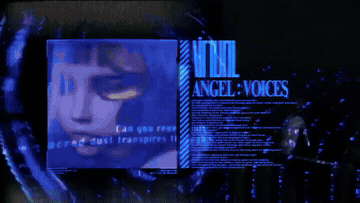
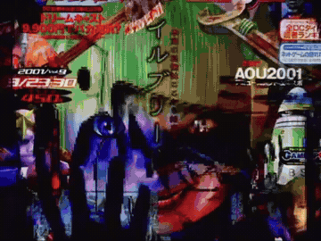

  
  

  

    𓅰 𓅬 𓅭 𓅮 𓅯
  

<!-- SOCIAL LINKS -->

  
  
  
  

  

<!-- TECHNOLOGY STACK -->

  

<!-- ANIMATED SCENE GALLERY -->

<table width="100%">
  <tr>
    <td align="center" width="33%">
      
    </td>
    <td align="center" width="33%">
      
    </td>
    <td align="center" width="33%">
      
    </td>
  </tr>
  <tr>
    <td align="center" width="33%">
      
    </td>
    <td align="center" width="33%">
      
    </td>
    <td align="center" width="33%">
      
    </td>
  </tr>
  <tr>
    <td align="center" width="33%">
      
    </td>
    <td align="center" width="33%">
      
    </td>
    <td align="center" width="33%">
      
    </td>
  </tr>
</table>

<!-- CONTRIBUTION SNAKE -->

  <picture>
    <source
      media="(prefers-color-scheme: dark)"
      srcset="https://raw.githubusercontent.com/BigSmoke4/BigSmoke4/output/github-contribution-grid-snake-dark.svg"
    />
    <source
      media="(prefers-color-scheme: light)"
      srcset="https://raw.githubusercontent.com/BigSmoke4/BigSmoke4/output/github-contribution-grid-snake.svg"
    />
    
  </picture>

<!-- TERMINAL DIVIDER -->

  

<!-- TERMINAL WINDOW -->

<table width="100%" align="center" cellpadding="0" cellspacing="0">
  <tr>
    <td
      bgcolor="#17121F"
      align="left"
      style="padding: 12px 16px; border: 1px solid #9D72D9;"
    >
      
      
      
      &nbsp;&nbsp;
    </td>
  </tr>
  <tr>
    <td
      bgcolor="#0D0B12"
      align="left"
      style="padding: 16px; border: 1px solid #9D72D9; border-top: none;"
    >
      <pre style="margin: 0; padding: 0; white-space: pre; overflow-x: auto;"><code>⠀⠀⠀⠀⠀⠀⠀⠀⠀⠀⠀⠀⠀⠀⠀⠀⠀⠀⠀⠀
:...:.:..:..:..:..:.:+%@#+::=++=-::--=+*%%%#+-::-#:#=++.-**%#@@@%#++=-:::-===--:::-:::::=*@@@#=:.::.
.....:..:..:..:....+%@*-:-+*=-:.::::::::-=#@@@*=-****#-+@@@@@@@%####%%%%#+-:::---::-==-:.::+%@@%+::.
.....:...........=@@+::=*=-:-=*#%%%#*+=====+@@@#*+%#*#%@@@@%%@@%%#+-::-=+#%%*=-::::::-=+=::.:=#@@@+:
.........:..:..-#@*::-+-:=*#%@@@@@@@@@#+=#++=@@@*#%=+##*++++*++=+#%%#*=:..:-=++=-:::::::=+=::::-#@@%
.....:........+@%-.:--:+#**%@@%%%##*##@%*-*===#*++=:::..::::-+*##+--=+##*-:..::::::::.....-+=:-:.=%@
..:..:..:..:.*@#:.:::-*++%@@@%###***===--::::.:::..............-+#%*-:::+#*=........::..   .=*=-=::*
...........:#@*.::::=*-*@@@%=::::--::...........................:-=*#*-:.:-+*+:.... ...:..  .:+*-==.
........:..#@*.--::==:#@@@*:......................................:-+**+-::::-++=:.......:.....-#==+
..:..:..:.+@#.-+::-=:%@@@*..........................................-=*#*+-:::::---:......::....:#+=
.........:@@-:*:::-:#@@@%...........................................:=-=+**+--:::-=-:::.:::::..:.:*#
.:....:..+@#.*=.:::+@@@@=............................................:=++==+==--::-=+=:::-:::::::::+
..:.....:#@+:*::::-@@@@#..............................................--=*#*++=-:::::=++--++-:::::::
..:..:..:%@=-=.=-.*@@@@-...............................................:=++#%#*++=-::::-+*==**---:::
.:.:..:.:%@=:::+::@@@@*...............................::-----::..........-***#%@%#*=-::::-+#++%*==::
.........#@*.:=+.=@@@%...........................:=+#%@@@@@@@@@%*=:.......-+*##%%%%%#+=:::.:+#*%%+*-
..:..:...=@%::=+.+@@@+--::...................:=*%@@@@@%**+====+*#%#*-......:-+***#####**+-::.-#%@@+*
.:...::...%@=.:=.+@@@@@@@%#=:..............=#@@@@@@%#**+*+**++++++=+*=:.......+*#%##*++====--:.=@@@*
...:::..:-#@%+***#@@%+**#%@@@*-...........-@@@@@%%%%%%%%@%%%%%%%%%%%%@##***+=--+***##%%##*+===-:-%@@
..:.::=#%%%%%%%%@%%%%@%%%####%%=........-*%%%%%#*+++=====-==+*%%##%#%@%%%%%%%%%%%@%%#**++++++=--::#@
..:::.*@##%%%@#+==*@==++#%@%%#%@+...::=#%%%%*=:-+++++=====--=:=%%#%#%@%%%%%%%%%%%%%%%%@@%%@%**#+-.:#
.:.::.:@%#%%@*-::.-@*.-=++##%%%%@####%%%%@*:..-+=+*##%#%%%%@#%*#@#%%@%:::-----==**#%%@@@@%+---=#%+::
....::.=@%#%@-=-=*+#@%%*##%##@@%#%%%%##%@@:.:.:+##+=%%@@#@@%@%##@##@@-..........-=+*##@@*::*%%%-#@*:
..:..:..*@#%@--+.+@@@@@#++@#@*@@%%#*#@%%@@-...+#=.. +#*#*%+%#-.+@#%@=...........:=++*##=.-%+:=@#-@@#
..:.::...*@#@#.+-:=*%%#=::**##%@@*...=%%%@%:..:-=====*#%%#*+=.-@%%@=.............:=+=::.=@%+:.%#:@@@
.:..:.:..:*@%@*:+-::%*-*****=-#%@-....-%%%@#:......::::::....=%%@%=....................:@*-#%:#+=@%@
..:..:..:..*@%@#=-.=@-.:....:*%@#......:#@%@%-.............-*%%@#:.....................-#+..%+#-#@#*
..:.::..:..*@%%@@#+%#.::::-+%@@#:........-#@@@*=-::.::::-+#%@@#=.......................#+:.:%=*+@@#=
::::.....::%@=:+#@@%%%#%%%@@%@*.....::.....-+#%@@%%###%%@@%#+-.....................::-#@+-=*=++@@@*:
.::..::.:.+@%::::@@@+++++==:*+......::...-:...:-=+****++=-:........................=:%@%+---=+%@%%=.
..:..:...=@%-.=-:@@@=.......#*....:--:...-*::.....................................*=.:-:.::-+@@@+*-:
:::....:+@#-.=+:*@@@%:......+@#+-:-=+#*-:+%:--...................................=@......:=%@@@%:*::
:::::-=#%+:-++:*@@@@@#......:+#%%#-...:-+=:..:..................................:%@*=-=+#@@@##@+.+::
..:=%%#+=+**=+%@%%%@@@*..........*-.............................................+@%@@@@@@@@#+@%::=::
..:.:+#%%##*#@@#=%+@@@@*......-====+*#*+=:.....................................:@@::*@@@%@%-#@+.::::
:..::..::-::%@@-=%-@#@@@+....*%%%%%%%#+*%%*=...................................+@+..#@@*%@=++@:::-::
:::.::..:..*@@#::#:*%+@@@=..-@%%%%%%%%%###%%#=:...............................:%@:..%@%=@#:+=%:::+::
::::.::::.:%@#+-:+=:##%@%#***%%%@@+---=+#@%%%%%=..............................+@#..:@@++@=:=-%::-#::
:::::::::.:@%=*=-:*##+=-:::---=+*#%%%%%@@@@@@@%@#:...........................:@@-..-@@-*@-:-:#-.-%::
.::::.::.::@@-+-*##=:...::---:----=+%@#+*#+++*%@@%:.........................:#@*...=@@:+@-:::=#.-@-:
..:.::..:::*@*:*@+-:.:------::..:--=+*%--:::::-=@@-........................-%@#....+@@--@=::::**.#*.
:::::::.::.:%@*@+=-------------::---*+##:----:-#@%.......................:*@@*.....+@@+.#*.::::#*-@+
.::::::.:.-*#*+=++------------------+*=@=---:=%%@+.....................:+@@@=......*@%#:-%-:=-.:*%#@
:::.::::.-@*----=++=---------------=*==@+:--+%%%%:...................=#@@@#:.......*@#*=.=%::+-:.=%@
:.:..:..:#@-------=+#+-------------==-*@+--#@+#@=.................:+%@@@%=.........*@@=#:.=%-:++:.:=
.::::.::.=@**=------=+=+==+**++*=-=**-*@*-#@%%@=...............:=*@@@@%=...........*@@#=*:.-#+:=*=:.
:::::.::.:+%@@%#%*-=---=+++-:::==-==---=%%@%@#-..............-*%@@@@%+:............*@@@==*:.:+*-:=+=
..:..:..:..:%#==#@*=+==-=-----::--==-++-%@%*-.............:+%@@@@@%+:..............+@@@@=-*-::-++=::
.::..:..:.::%#++==%%%###@#+===+=--+=-+=+@+.............:=#@@@@@@%=:................:@@*%@*:=-:-=--=-
:::::.::.:.-@+-=**==**--+#*%%@%*++=---+@+...........:=#@@@@@@@%=....................*@@+#@%=-::-+++=
::::::..::.=@**==*=--*+++*#=-=##@@###@@+:......::=*#@@@@@@@@#=......................:@@@++%@#+-:::-+
::::.:=**#*%@##*==#+++*+--+#====%%++=+%@@#####%@@@@@@@@@@@#=.........................=@@@%++##*+=-::
::::.+%=:::::--=+##%=--*+++**-=@%-:=:::#@@@@@@@%%@@@@@@@#=............................-#@@@%#++++=-:
::::+@-..........-%@%**+#+--+#@#:--+--==@@@@@@@*.=%@@%*-...............................:=#@@@%%####*
:::-@=..-=++#*-..=%%%@%+-#*=+@@+.++*+:*=@#%@@@@@:..::.....................................-*%@%%##**
:::%+.:-=*%@@%%#*++*%@@%+=++@@@*:%+%--##@*@@@@@@+...........................................:-*%@@@@
.:%%+***+---=***#+*#%#+#+=#@*-@%#%%*:#@@##@@@@@@%......................-:.......................:=*#
+#%*+-:......:=*#*--+==+##@=.:@@@%+-#@@@%@@@@%%@@-....................=+............................
-:......::......-#*+=#+=%@=..#@@#*#@@@@@@@%%#%@@@*...................=*...........................-#
::-=+++**+*+:.....=##=+%%-..+@@@@@@@@@@@%###%@@=#@:.................-#:.........................:+@@
++==--:::.:+%*-.....=%@@-..-@@%%%%%#%@%####%@%-.=@=................-*:.........................=%@%#
............:*@#:....#@-::-%@######@@%####%@#:..:@*..::...........-*:.....................::.:#@@###
---=====-.....=%%..-#%@:.-@@#####%@%####%@@+....-@*...=:.........-=..............:::-==+=--:+@@%####
+===---+#*-....:#*.+%%@-=@@#####%%%####%@@@%*=--*@-...+=........::.:-=++++**********+=--:.:#@%######
........:=**:....##=@%@*@@#####%%#####%@%:-=+***+:....-*........-+####****+++==-::.......-%@%#######
..::=+:....=*=..:*@@##*@@######%#####%@%:..............=......-++=::....................+@@########%
*#%@@@%+-...-@:+%%@+.:#@%###########%@%-...............:.....:::......................:*@%########%@
%#*@@@*@@=.-%@*+%%@-.+@%###########%@@-..............................................:%@%########%@%
:..*@%=+#@*=%%@%%@%.-@@###########%@@+..............................................-%@%#########@%#
...=@#=***@@#%%+-=:-%@%%%#########%@#..............................................=@@##########@@##
...=@*=-#@*-.:....-%@%#%%########%@@:............................................:+@%##########%@###
.:.+@=+%@%-......-%@##%@#########@@+............................................:#@%##########%@%###
    
  </tr>
</table>

<!-- ANIMATED TERMINAL COMMANDS -->

  

  

<!-- GITHUB STATISTICS -->

  
  

<!-- GITHUB STREAK -->

  

  

  <em>𝕍𝕖𝕟𝕚. 𝕍𝕚𝕕𝕚. 𝕍𝕚𝕔𝕚.</em>

